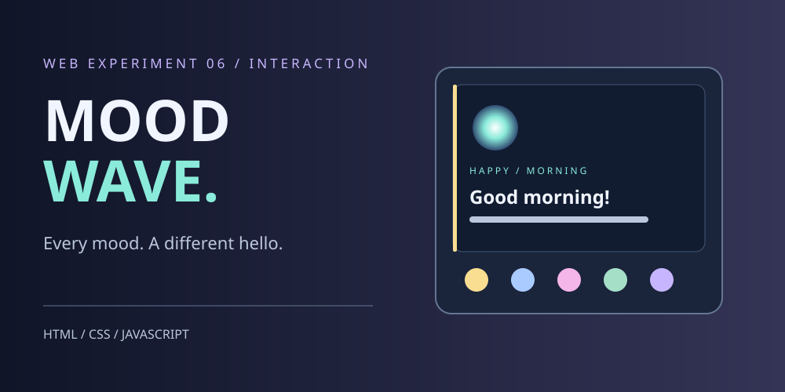

# MoodWave — Mood-Based Greeting Generator



A browser-based personalized greeting application created for Web Experiment 06. It combines a name, a selected mood and the device's local hour to produce a friendly, rule-based message.

**Status:** Academic project / implemented frontend prototype. Browser and live deployment verification pending.

## Features
- Five original moods: happy, sad, excited, tired and neutral.
- Four local-time greetings: morning, afternoon, evening and night.
- Fifteen curated message variations with random selection.
- Mood and time styling applied independently, fixing the original class-reset issue.
- Form validation, regenerate, copy and reset controls.
- Accessible labels, live result announcements and reduced-motion support.
- No server, API, external AI service, or persistent storage.

## Run locally

Open `index.html` or serve the repository:

```bash
python -m http.server 8000
```

Visit http://localhost:8000. Clipboard access depends on browser permissions and a secure context.

## Project structure

- `index.html`: semantic generator and result panel.
- `styles.css`: responsive layout and independent time/mood themes.
- `script.js`: greeting rules, validation and browser interactions.
- `tests/greeting.test.js`: regression tests.
- `assets/cover.svg`: original concept artwork.

## Tests

With Node.js 18+:

```bash
node --test tests/greeting.test.js
```

Manual browser checks: blank fields, mood changes, regenerate, reset, clipboard denial, keyboard navigation, reduced motion and mobile layouts.

## Limitations

The application generates predefined greetings, not AI-generated advice or mental-health assessments. It does not store or transmit names or mood choices. No live link is listed until verified.

## Learning objectives

Practice conditional logic, arrays and objects, random selection, Date APIs, DOM updates, event handlers and responsive styling.
